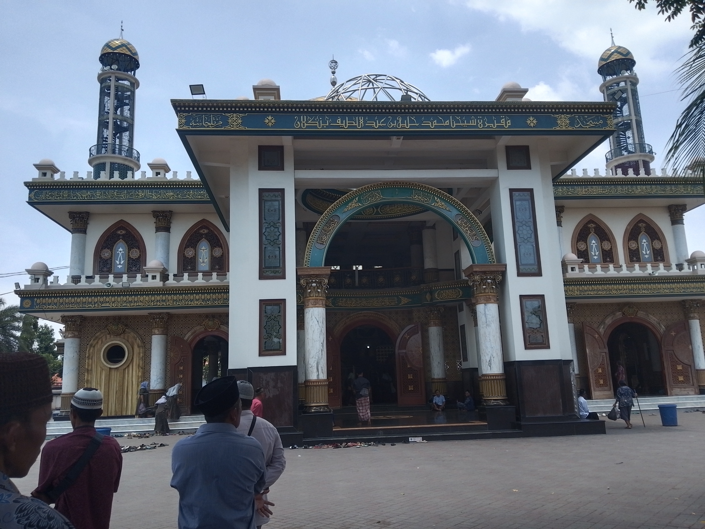
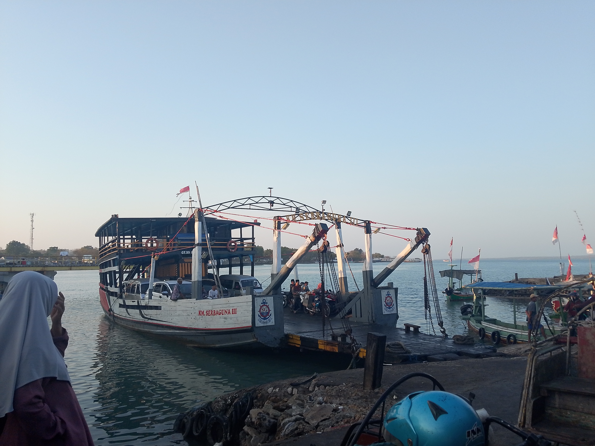
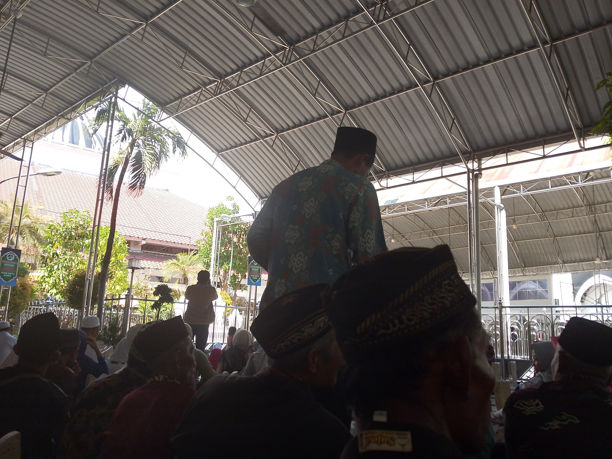

Sekian lama tidak ikut Ziarah Wali akhir nya tahun ini bisa ikut lagi, disinis saya ikut rombongan ibu jamaah tahlil kampung saya khusus nya dusun mabang. 

Membayar kursi dengan harga 150 ribu tentu sangatlah murah, dari dulu ingin ikut Ziarah wali namun tidak memiliki uang cukup dan banyak pengeluaran. 

Selain Jawa saya sendiri juga baru tau kalau di madura ada juga makam para wali yang sering di datengin para perziarah dari jawa. 

Di Madura tempat yang di kunjungi adalah :

- Makam Mbah Kholil
- Asta Tinggi
- Aer Mata Ibu
- Batu Ampar
- Sunan Cendana
- Bujuksara
- Sunan Ampel

Tentu dari ke lima makam yang ada dimadura ini adalah merupakan tempat yang sering di kunjungi para ziarah dari luar medura. 

Berikut ini beberapa tips dan tempat - tempat yang sesui urutan untuk di kunjungi kalau kalian wisata religi ke madura. 

## 1. Bujuksara
Bujuksara ini merupakan tempat Ziarah Wali di Madura yang dikunjungi, karena ini berada di bangkalan serta dekat dengan suramadu serta tidak jauh dari tempat kedua

Bujuk Sara adalah komplek makam tokoh ulama atau penyebar Islam yang dikeramatkan (bujuk / buyut) di Madura, terletak di Desa Martajasah, Kecamatan Bangkalan, Kabupaten Bangkalan, sekitar 200 meter dari makam Syaikhona Kholil.

### Isi Komplek Makam Bujuk Sara

Komplek ini terdiri dari tiga makam utama:
1. Sayyid Abdullah (di sebelah kanan) — merupakan salah satu guru Thoriqoh dari Syaikhona Kholil Bangkalan.
2. Sayyidah Siti Maisarah (di bagian tengah) — yang sering kali namanya menjadi asal-sebutan dari Bujuk Sara.
3. Syeikh Syarifuddin (di sebelah kiri) — yang diyakini merupakan keturunan dari Syaikh Abdul Qadir Al-Jailani.

Di halaman makam terdapat sumur keramat peninggalan Sayid Abdullah yang airnya sering digunakan peziarah (dipercayai membawa keberkahan atau membuat awet muda). 

Kalian untuk sampai ke makam Bujuksara ini tentu harus jalan kaki sekitar 100 meter untuk sampai makam ini. 

## 2. Makam Mbah Kolil Bangkalan

Selanjutnya yang kedua adalah makam Mbah Kolil Bangkalan yang mana butuh beberapa menit saja dari Bujuksara ini. 

Makam Syaikhona Kholil (Mbah Kholil) adalah salah satu destinasi wisata religi paling utama di Pulau Madura. Syaikhona Kholil dikenal sebagai maha guru dari para ulama besar di Nusantara, termasuk pendiri Nahdlatul Ulama, KH. Hasyim Asy'ari.

Makam Mbah Kolil Bangkalan selalu ramai di datangi oleh pengunjung dan tidak pernah sepi, karena lokasi nya berada di Dalam Masjid jadi banyak para Ziarah ke Masjid dulu untuk solat dan selanjutnya Ziarah ke Makam Mbah Kolil. 

Makam ini berada di dalam komplek Masjid Syaikhona Kholil yang megah, tepatnya di Desa Martajasah, Kabupaten Bangkalan. Komplek ini sudah dilengkapi akses ramah disabilitas (wheelchair accessible) dan toilet umum yang memadai.

Seperti yang sempat dibahas sebelumnya, komplek makam ini juga terletak sangat dekat (hanya berjarak sekitar 200 meter) dari Bujuk Sara, sehingga para peziarah umumnya mendatangi kedua tempat suci ini sekaligus dalam satu rangkaian kunjungan.

Apakah Anda membutuhkan rekomendasi kuliner khas Bangkalan terdekat untuk dikunjungi setelah berziarah, atau ingin mengetahui estimasi waktu perjalanan dari lokasi Anda saat ini?

## 3. Aermata Ibu

Selanjutnya ke Aermata Ibu yang mana masih di Kabupaten Bangkalan yang dikunjungi. 

Makam Aer Mata Ibu (sering disebut Aermata Ebu atau Pasarean Ratu Ibu) adalah kompleks pemakaman kuno bangsawan Madura dari Wangsa Cakraningrat. Terletak di Desa Buduran, Kecamatan Arosbaya, Kabupaten Bangkalan, situs ini berjarak sekitar 11–12 km ke arah utara dari pusat Kota Bangkalan.

### Asal-Usul Nama & Legenda Ratu Ibu

Nama "Aer Mata Ibu" merujuk pada kisah pilu Syarifah Ambami (Ratu Ibu), keturunan Sunan Giri yang menjadi permaisuri Raden Praseno (Panembahan Cakraningrat I).

- **Pertapaan Ratu Ibu**: Karena suaminya sering bertugas di Kerajaan Mataram, Ratu Ibu menghabiskan waktu bertapa di Arosbaya guna mendoakan agar keturunannya kelak dipercaya menjadi penguasa Madura hingga 7 turunan.
- **Kemarahan Sang Raja**: Saat mendengar cerita tersebut, Cakraningrat I justru kecewa. Beliau berharap kepemimpinan itu bertahan selamanya, bukan dibatasi hanya sampai 7 turunan.
- **Tangisan Abadi**: Merasa sangat bersalah dan sedih atas kekecewaan suaminya, Ratu Ibu kembali bertapa sambil terus-menerus menangis memohon ampunan, hingga air matanya membanjiri tempat pertapaan tersebut sampai beliau wafat.

Jika kalian disini tentu harus jaga uang kalian karena disini banyak sekali pengemis yang mana apabila kalian kasih akan ikuti kalian terus. 

Jadi lebih baik tidak usah beri uang, lebih baik uang kalian kasih aja ke kotak amal yang ada disana dan membeli air yang ada disana dengan harga 5 ribu rupiah sebotol nya. 

## 4. Makam Sunan Cendana
Makam Sunan Cendana (Syekh Zainal Abidin atau Pangeran Purna Jiwa) merupakan salah satu destinasi ziarah Wali legendaris di Madura. Kompleks pemakaman kuno ini terletak di Desa Ketetang, Kecamatan Kwanyar, Kabupaten Bangkalan.

Sunan Cendana dikenal sebagai ulama besar penyebar Islam di kawasan Madura Barat serta leluhur dari banyak ulama terkemuka di Madura dan Jawa Timur, termasuk masih memiliki garis keturunan dengan Syaikhona Kholil Bangkalan.

### Asal-Usul Nama & Sejarah

- **Gelar Sunan Cendana**: Nama "Cendana" melekat karena dahulu di sekitar tempat pertapaan dan dakwah beliau di Kwanyar banyak ditumbuhi pohon cendana yang mengeluarkan aroma sangat wangi.
- **Garis Keturunan Ningrat**: Beliau merupakan cucu dari Sunan Kudus (Jafar Sadiq) dari jalur sang ayah. Sementara ibunya adalah keturunan dari Kerajaan Mataram Islam.
- **Pelarian Spiritual**: Dikisahkan bahwa beliau pergi ke Madura untuk menghindari pergolakan politik dan kekejaman Sultan Amangkurat I di Jawa. Di Madura, beliau memfokuskan hidupnya untuk menyebarkan syiar Islam hingga wafat dan dimakamkan di Kwanyar.

## 5. Persarean Batu Ampar

Selanjunya adalah Persarean Batu Ampar yang di kunjungi, karena tempatnya jauh jadi di tempat ini pas magrib, Jika kesini disaran kan untuk naik ojek karena berjalan ke makam nya lumayan jauh. 

Pesarean Batu Ampar (Makam Wali Batu Ampar Barat) adalah salah satu kompleks pemakaman religi paling keramat dan legendaris di Pulau Madura. Kompleks makam kuno ini terletak di Dusun Batu Ampar, Desa Pangbatok, Kecamatan Proppo, Kabupaten Pamekasan.

Berbeda dengan makam-makam sebelumnya yang berada di Bangkalan (Madura Barat), Batu Ampar terletak di Madura Tengah dan menjadi pusat ziarah spiritual yang menyedot jutaan umat Islam dari berbagai daerah.

### Kompleks 6 Makam Wali Allah

Di dalam komplek pesarean ini, terdapat makam para ulama dan buju' (buyut) penyebar Islam yang terikat dalam satu garis keturunan. Tokoh yang paling masyhur di antaranya:

1.  (Syekh Abdul Manan) — Ulama perintis dan salah satu tokoh utama dari silsilah Wali Batu Ampar.
2. Buju’ Tumpeng (Syekh Muhammad Syamsuddin) — Putra dari Buju' Abdul Manan, dikenal dengan julukan ini karena keteguhannya dalam bertapa/tirakat demi umat.
3.  (Syekh Arif) — Cucu dari Buju' Abdul Manan, diberi julukan Lattong (kotoran sapi) karena karomah beliau yang mampu menyembunyikan identitas spiritualnya agar tidak pamer di hadapan manusia.
Para ulama Batu Ampar ini juga merupakan leluhur dari banyak kiai besar di Jawa Timur, termasuk para pendiri pondok pesantren legendaris di Madura.

### Asal-Usul Nama & Tradisi Ziarah

- Arti Nama: Nama Batu Ampar berasal dari bahasa Madura yang berarti batu yang menghampar atau membentang, merujuk pada kondisi geografis perbukitan batu di sekitar lokasi pertapaan para pemuka agama tersebut,
- Keunikan Spritual Khataman: Situs religi ini terkenal sebagai tempat berkumpulnya jutaan umat yang melakukan khataman Al-Qur'an. Kompleks ini juga pernah menjadi tempat ziarah dan iktikaf favorit dari Presiden RI ke-4, KH. Abdurrahman Wahid (Gus Dur).

## 6. Asta Tinggi

Selanjutnya adalah Asta Tinggi, Siapa itu Asta Tinggi? **Asta Tinggi** (Astah Tegghih) adalah kompleks pemakaman suci khusus bagi raja-raja dan keluarga bangsawan Keraton Sumenep. Terletak di kawasan dataran tinggi Desa Kebonagung, Kecamatan Kota Sumenep, Kabupaten Sumenep, situs ini merupakan salah satu episentrum wisata religi paling megah dan bersejarah di ujung timur Pulau Madura.
Dalam bahasa Madura, kata Asta berarti makam atau kuburan (sering dikaitkan dengan kediaman para tokoh dihormati), sementara Tinggi merujuk pada lokasinya yang berada di area perbukitan.

Asta Tinggi (Astah Tegghih) adalah kompleks pemakaman suci khusus bagi raja-raja dan keluarga bangsawan Keraton Sumenep. Terletak di kawasan dataran tinggi Desa Kebonagung, Kecamatan Kota Sumenep, Kabupaten Sumenep, situs ini merupakan salah satu episentrum wisata religi paling megah dan bersejarah di ujung timur Pulau Madura.
Dalam bahasa Madura, kata Asta berarti makam atau kuburan (sering dikaitkan dengan kediaman para tokoh dihormati), sementara Tinggi merujuk pada lokasinya yang berada di area perbukitan.

### Pembagian Kawasan Kompleks Makam
Kompleks pemakaman kuno yang mulai dibangun sejak kurun tahun 1600-an ini memiliki tata ruang yang unik dan terbagi menjadi beberapa klaster utama berdasarkan garis keturunan dan masa pemerintahan:

- Bagian Barat (Kubah Utama): Merupakan area makam tua yang dibangun oleh Pangeran Rama (Pangeran Cokronegoro II). Di area ini disemayamkan para penguasa awal dan tokoh besar, seperti Pangeran Pulang Jiwa (Pangeran Sidomukti) dan Pangeran Jimat.
- Bagian Timur: Merupakan area makam keturunan dari jalur (Tumenggung Tirtonegoro) dan putranya yang sangat terkenal, Panembahan Somala (Sultan Abdurrahman Pakunataningrat). Kelompok makam ini memiliki pengaruh gaya arsitektur yang lebih modern pada zamannya.

### Keunikan Arsitektur Akulturasi Budaya

Daya tarik utama dari Asta Tinggi selain nilai spiritualnya adalah kemegahan visual bangunannya:

- **Gateng (Gerbang Utama)**: Pintu masuk utama berbentuk gapura megah yang memadukan corak arsitektur Islam, Hindu-Jawa, serta kolonial Eropa (Belanda). Pengaruh arsitektur ini menunjukkan kuatnya hubungan diplomasi Keraton Sumenep dengan bangsa luar di masa lalu.
- **Kubah Makam Berwarna-warni**: Kompleks makam ini tidak terasa suram, melainkan tampak indah berkat bangunan kubah (kubah pangeran) bercat kuning dan hijau cerah yang bergaya khas bangunan keraton.

## 7. Makam Sayyid Yusuf

Ini merupakan Tujuan Terakhir saat Ziarah Wali ke Madura, untuk sampai ke makam ini tentu kalian harus naik kapal supaya sampai ke makam nya. 

Setelah naik kapan kalian harus naik becak motor untuk menuju makam nya, karena tempat nya masih jauh dari pelabuhan. 

Di Pulau Poteran, Kecamatan Talango, Kabupaten Sumenep, terdapat makam yang paling terkenal yaitu makam Sayyid Maulana Yusuf Bin Ali Bin Abdullah Al-Hasani (atau sering disebut Sayyid Yusuf Talango), serta makam Nyai Jasmani (Ebu Jasmani / Buju' Kangean).

### 1. Makam Sayyid Yusuf (Asta Sayyid Yusuf)

- Siapa beliau: Seorang ulama dan penyebar agama Islam yang sangat dihormati di Talango, Sumenep.
- Sejarah singkat: Berdasarkan kisah lokal, makam ini pertama kali ditemukan pada tahun 1791 M (1212 H) oleh Raja Sumenep, Sri Sultan Abdurrahman Pakunataningrat, yang melihat seberkas cahaya jatuh di pulau tersebut dan kemudian menemukan tanda nama pada nisan. Sebagian tradisi lisan juga mengaitkan nama beliau dengan Syekh Yusuf Al-Makassari.

### 2. Makam Nyai Jasmani (Ebu Jasmani / Buju' Kangean)

- Siapa beliau: Seorang tokoh perempuan yang diyakini berasal dari Pulau Kangean (Desa Pandeman) yang kemudian menetap di Pulau Poteran setelah menikah.
- Lokasi: Ujung timur Pulau Poteran, Kecamatan Talango.
Jika Anda ingin mengetahui rute penyeberangan perahu dari Pelabuhan Kalianget menuju Pulau Poteran atau jam kunjungan ziarah.

## 8. Makam Sunan Ampel

Tujuan Terakhir adalah makam sunan ampel yang ada di surabaya, tentu bagi kalian yang suka wisata religi di jawa khusus nya di jawa timur tentu makam sunan ampel ini banyak di kunjungi para peziarah dari penjuru kota. 

Makam Sunan ampel ini tidak pernah sepi dari para peziarah srtiap hari nya. 

Sunan Ampel (Raden Rahmat) adalah salah satu tokoh Wali Songo tertua yang menjadi pilar utama penyebaran Islam di Pulau Jawa. Beliau mendirikan Pesantren Ampel Denta di Surabaya, yang menjadi pusat pendidikan Islam tertua di Nusantara sekaligus mencetak ulama-ulama besar dan para wali setelahnya.

### Ajaran Legendaris: Moh Limo
Filosofi dakwah Sunan Ampel yang paling terkenal dan masih relevan hingga saat ini adalah Moh Limo (tidak mau melakukan lima hal tercela):

1. Moh Main: Tidak mau berjudi.
2. Moh Ngombe: Tidak mau minum minuman keras / mabuk.
3. Moh Maling: Tidak mau mencuri atau korupsi.
4. Moh Madat: Tidak mau mengonsumsi narkoba / candu.
5. Moh Madon: Tidak mau berzina / bermain perempuan.

## Kompleks Makam & Masjid Agung Ampel

Kompleks Wisata Religi Sunan Ampel terletak di Kecamatan Semampir, Kota Surabaya. Situs ini menjadi tujuan ziarah lanjutan yang sangat krusial bagi para peziarah yang menempuh rute religi dari Madura (melalui Jembatan Suramadu).
- Gerbang & Akulturasi Budaya: Kompleks ini memiliki 5 gapura kuno ikonik yang melambangkan rukun Islam. Arsitekturnya memadukan corak Hindu-Jawa, Arab, dan Tiongkok.
- Makam Tokoh Unik di Sekitarnya: Tepat di belakang Masjid Agung Ampel, selain makam utama Kanjeng Sunan Ampel dan istrinya (Dewi Condrowati), terdapat dua makam murid setianya yang sangat masyhur karena karomahnya:
  - Makam Mbah Soleh: Terkenal dengan kisah ajaibnya yang diceritakan memiliki 9 makam karena hidup kembali sebanyak 9 kali untuk membersihkan masjid.
	- Makam Mbah Sonhaji (Mbah Bolong): Dikenal karena karomahnya yang mampu melihat arah kiblat Ka'bah di Mekah secara langsung hanya dengan melubangi dinding masjid.
- Suasana & Kuliner Kampung Arab: Area di sekitar makam merupakan kawasan cagar budaya "Kampung Arab". Sepanjang koridor masuk, Anda akan melewati pasar tradisional yang menjual busana muslim, kurma, parfum, hingga kuliner khas Timur Tengah dan Yaman.

